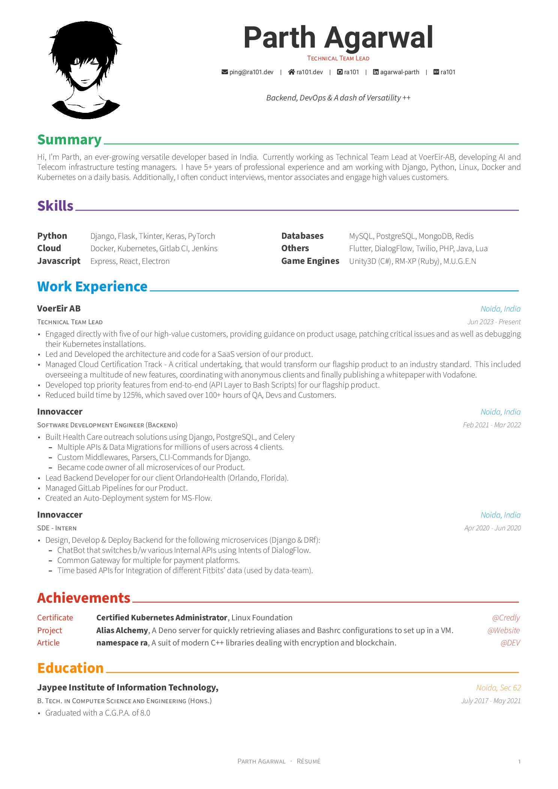
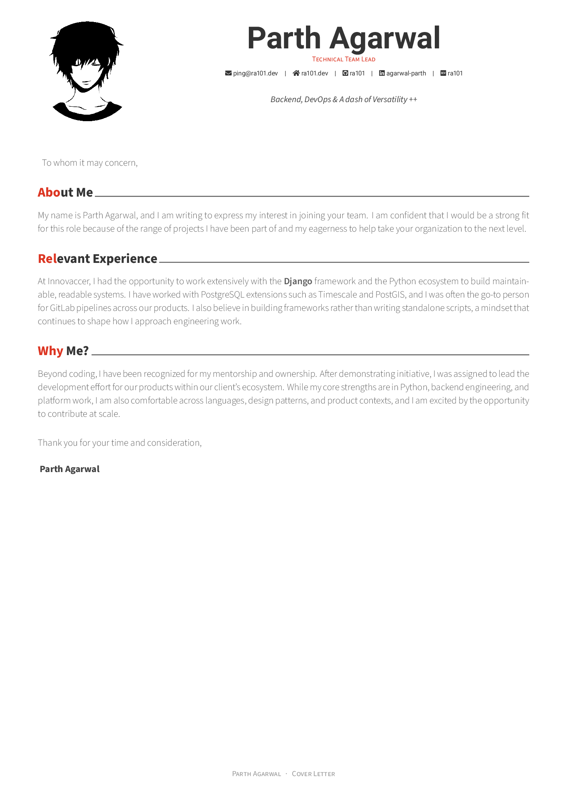

<h1 align="center">
  <a href="https://github.com/posquit0/Awesome-CV" title="AwesomeCV Documentation">
    
  </a>
  <br />
  Awesome CV
</h1>

<p align="center">
  LaTeX template for your outstanding job application
</p>

<div align="center">
  
  
  
  <a href="https://www.buymeacoffee.com/ra101">
    
  </a>
</div>

<br />

## What is Awesome CV?

**Awesome CV** is LaTeX template for a **Résumé** and/or **Cover Letter** inspired by [Fancy CV](https://www.sharelatex.com/templates/cv-or-resume/fancy-cv). It is easy to customize your own template, especially since it is really written by a clean, semantic markup.

This project is a Dockerized fork of [Awesome-CV](https://github.com/posquit0/Awesome-CV), customized for my own (although customizable) résumé and cover letter content, build workflow, and contact details.

## Preview

| Résumé | Cover Letter |
| :---: | :---: |
| [](.assets/resume.png) | [](.assets/coverletter.png) |


| Referral Message with Job Link                                                                                                                                                                                                                                                                                                                                                                                                                                                                                                                                                                                                                                                                                                                                                                                                                                                                                                             | Referral Message without Job Link                                                                                                                                                                                                                                                                                                                                                                                                                                                                                                                                                                                                                                                                                                                                                                                                                                                                                                                |
| ------------------------------------------------------------------------------------------------------------------------------------------------------------------------------------------------------------------------------------------------------------------------------------------------------------------------------------------------------------------------------------------------------------------------------------------------------------------------------------------------------------------------------------------------------------------------------------------------------------------------------------------------------------------------------------------------------------------------------------------------------------------------------------------------------------------------------------------------------------------------------------------------------------------------- | ------------------------------------------------------------------------------------------------------------------------------------------------------------------------------------------------------------------------------------------------------------------------------------------------------------------------------------------------------------------------------------------------------------------------------------------------------------------------------------------------------------------------------------------------------------------------------------------------------------------------------------------------------------------------------------------------------------------------------------------------------------------------------------------------------------------------------------------------------------------------------------------------------------------------------- |
| <blockquote>Hi Tim,<br><br>I'm Parth, a Technical Team Lead with 5+ years of experience at VoerEir-AB, architecting AI and Telecom infrastructure benchmarking solutions for global clients such as Google, AWS, Red Hat, and Vodafone. Expert in AI-native Development, LangGraph, Django, Python, Linux, Docker and Kubernetes. Additionally, I often conduct interviews, mentor associates and engage with high value customers.<br><br>Would you be open to sharing my attached Resume and Cover Letter with the hiring team for the "Staff Software Engineer" role?<br><br>I believe my experience in backend engineering, technical leadership, cloud-native architecture, and AI-enabled product development would be valuable to Google.<br><br>Job Link: https://google.com/jobs/staff-sde-remote/<br><br>I am looking forward to working with you. But In any case, Thank you so much, I know It was a long message😅, PFA.</blockquote> | <blockquote>Hello,<br><br>I'm Parth, a Technical Team Lead with 5+ years of experience at VoerEir-AB, architecting AI and Telecom infrastructure benchmarking solutions for global clients such as Google, AWS, Red Hat, and Vodafone. Expert in AI-native Development, LangGraph, Django, Python, Linux, Docker and Kubernetes. Additionally, I often conduct interviews, mentor associates and engage with high value customers.<br><br>I see that there are no public openings at your company. But if there are any openings on your company's intranet, would you be open to sharing my attached Resume and Cover Letter?<br><br>I believe my experience in backend engineering, technical leadership, cloud-native architecture, and AI-enabled product development would be valuable to your organization.<br><br>I am looking forward to working with you. But In any case, Thank you so much, I know It was a long message😅, PFA.</blockquote> |


## How to Use

#### Requirements

- Podman or Docker installed and running on your machine
- `just` or `make` available in your shell environment

#### Usage

From the project root, run either of the following:

```shell
# Generate both outputs
just all || make all

# Generate one output at a time
just resume || make resume
just coverletter || make coverletter
```

This creates the `.pdf` and `.png` for **cover letter** and/or **resume** inside the `output/` directory.


<br>

```shell
# Generate a referral message
sh referral_message.sh

# Generate a referral message with custom values
sh referral_message.sh --recipient "Tim" --company "Google" --role "Staff Software Engineer"
```

This prints the referral message to the terminal and copies it to your clipboard for quick sharing.


<br>

## 🌟Credit/Acknowledgment

[**posquit0**](https://github.com/posquit0) and [**OJFord**](https://github.com/OJFord) are the awesome developers that maintains the original project.

[**LaTeX**](https://www.latex-project.org) is a fantastic typesetting program that a lot of people use these days, especially the math and computer science people in academia.

[**FontAwesome6 LaTeX Package**](https://github.com/braniii/fontawesome) is a LaTeX package that provides access to the [Font Awesome 6](https://fontawesome.com/v6/icons) icon set.

[**Roboto**](https://github.com/google/roboto) is the default font on Android and ChromeOS, and the recommended font for Google’s visual language, Material Design.

[**Source Sans Pro**](https://github.com/adobe-fonts/source-sans-pro) is a set of OpenType fonts that have been designed to work well in user interface (UI) environments.

<br>

## 📜License

[](https://github.com/ra101/Awesome-CV/blob/core/LICENSE)

<br>

## 🤙Contact Me

[](mailto://ping@ra101.dev) [](https://telegram.me/ra_101)
